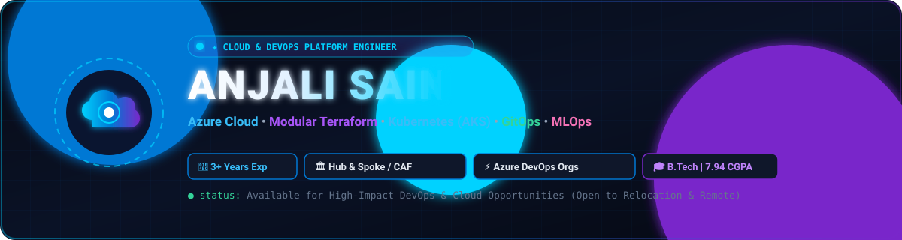
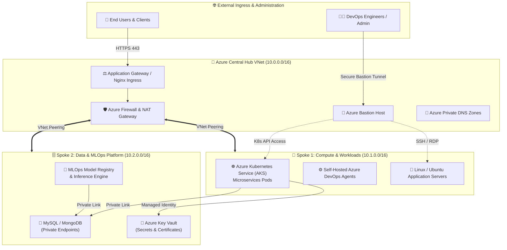

<div align="center">

  <!-- Guaranteed Local SVG Vector Banner -->
  <a href="https://www.linkedin.com/in/anjali-sain-devops">
    
  </a>

  <br/>

  <!-- Local Guaranteed Animated Typing Terminal (Always Loads Everywhere, Adblocker Proof) -->
  <a href="https://www.linkedin.com/in/anjali-sain-devops">
    
  </a>

  <br/><br/>

  <!-- High-Impact Status Badges -->
  <a href="#-work-experience">
    
  </a>
  <a href="#-core-architectural-competencies">
    
  </a>
  <a href="#-education--foundation">
    
  </a>
  <a href="mailto:sainanjali083@gmail.com">
    
  </a>

  <br/><br/>

  <!-- Quick Recruiter Action Bar -->
  <a href="https://www.linkedin.com/in/anjali-sain-devops" target="_blank">
    
  </a>
  &nbsp;
  <a href="mailto:sainanjali083@gmail.com">
    
  </a>
  &nbsp;
  <a href="mailto:sainanjali083@gmail.com?subject=Job%20Opportunity%20-%20DevOps%20%26%20Cloud%20Engineer">
    
  </a>
  &nbsp;
  <a href="https://github.com/sainanjali">
    
  </a>

  <br/><br/>

  <!-- Interactive Skill Icons Strip -->
  <a href="https://skillicons.dev">
    
  </a>

</div>

---

## 👩‍💻 Executive Summary

> **"Results-driven DevOps & Cloud Engineer with 3 years of combined experience across full-time engineering, freelance consulting, and technical internships. Specialized in architecting resilient cloud platforms, automating end-to-end CI/CD delivery, and operationalizing production Kubernetes and MLOps pipelines."**

### 🎯 Key Business & Engineering Impact
* ☁️ **Enterprise Azure Landing Zones:** Architected modular, secure cloud foundations adhering to the **Microsoft Cloud Adoption Framework (CAF)** with **Hub-and-Spoke** network topologies, VNet Peering, Azure Bastion, and Private Endpoints.
* 🧱 **Modular Infrastructure as Code (IaC):** Engineered reusable **Terraform modules**, enforced remote state management with **Azure Blob Storage & Lease Locking**, and automated compliance checks via **Checkov, tfsec, and TFLint**.
* ⚡ **Azure DevOps Organizations & CI/CD:** Designed multi-stage YAML pipelines with centralized **YAML step/job templates**, custom **Self-Hosted and Microsoft-Hosted build agents**, environment approval gates, and variable groups.
* ☸️ **Kubernetes (AKS), Containers & GitOps:** Containerized multi-tier services with **Docker**, deployed and managed **Azure Kubernetes Service (AKS)** clusters with **Helm**, and implemented **GitOps** workflows for declarative zero-downtime releases.
* 🤖 **AI & MLOps Pipelines:** Automated continuous model validation, packaging, and serving for machine learning models, deploying scalable containerized inference endpoints on AKS.
* 🛡️ **DevSecOps & Zero-Trust Governance:** Built shift-left security gates with **Gitleaks** secret detection, container vulnerability scanning, **Azure Key Vault**, and least-privilege **RBAC**.
* 🌐 **High Availability & Reverse Proxying:** Hardened and tuned **Nginx** for load balancing and reverse proxying, achieving **99.9% uptime** and fast SSL/TLS termination.

---

## 🏗️ Core Architectural Competencies

<table>
  <tr>
    <td width="50%" valign="top">
      <h3>☁️ Enterprise Azure Cloud Architecture</h3>
      <ul>
        <li><b>Landing Zones & CAF:</b> Greenfield & brownfield enterprise cloud foundations aligned with Cloud Adoption Framework principles.</li>
        <li><b>Hub-and-Spoke Topology:</b> Centralized inspection hub with Azure Firewall / NAT Gateway peered to isolated application spoke VNets.</li>
        <li><b>Zero-Trust Networking:</b> Azure Private Endpoints, Private Link, Network Security Groups (NSGs), and Azure Bastion host access.</li>
        <li><b>Multi-Cloud Exposure:</b> Deep Microsoft Azure core with AWS and GCP hybrid deployment familiarity.</li>
      </ul>
    </td>
    <td width="50%" valign="top">
      <h3>🧱 Modular Infrastructure as Code (IaC)</h3>
      <ul>
        <li><b>Modular Terraform:</b> DRY, re-usable module hierarchies separating networking, compute, AKS, databases, and security.</li>
        <li><b>State Management:</b> Remote state stored in Azure Blob Storage with automated lease locks, workspaces, and zero state drift.</li>
        <li><b>Shift-Left Compliance:</b> Pre-deployment policy validation using <code>Checkov</code>, <code>tfsec</code>, and <code>TFLint</code>.</li>
        <li><b>Configuration Management:</b> Linux automation, systemd services, and cloud-init provisioning.</li>
      </ul>
    </td>
  </tr>
  <tr>
    <td width="50%" valign="top">
      <h3>⚡ Azure DevOps Org & CI/CD Pipelines</h3>
      <ul>
        <li><b>Multi-Stage YAML Pipelines:</b> Automated pipelines across Build, Static Code Analysis, Unit Testing, Artifact Release, and Multi-Environment Deployments.</li>
        <li><b>Reusable Templates:</b> Standardized step, job, and deployment templates across repositories enforcing consistency.</li>
        <li><b>Custom Agent Pools:</b> Configured, scaled, and maintained Self-Hosted Linux/Windows build agents alongside cloud agents.</li>
        <li><b>Release Governance:</b> Environment gates, manual approval checks, variable groups, and Azure Key Vault secret injection.</li>
      </ul>
    </td>
    <td width="50%" valign="top">
      <h3>☸️ Kubernetes, Containers & GitOps</h3>
      <ul>
        <li><b>Azure Kubernetes Service (AKS):</b> Cluster provisioning, node pool autoscaling, HPA, Pod Disruption Budgets, and RBAC.</li>
        <li><b>Ingress & Reverse Proxy:</b> High-performance traffic routing via <b>Nginx Ingress Controller</b>, SSL/TLS termination, and load balancing.</li>
        <li><b>Packaging & Helm:</b> Parametric Helm charts for microservice deployments, secret management, and configuration versioning.</li>
        <li><b>GitOps Philosophy:</b> Declarative, Git-based single source of truth for cluster state and automated drift reconciliation.</li>
      </ul>
    </td>
  </tr>
  <tr>
    <td width="50%" valign="top">
      <h3>🤖 AI & MLOps Infrastructure</h3>
      <ul>
        <li><b>MLOps Lifecycles:</b> Automated CI/CD pipelines for model validation, model artifact packaging, and container registry publishing.</li>
        <li><b>Model Serving on AKS:</b> Containerized REST inference endpoints deployed to AKS with autoscaling and health probes.</li>
        <li><b>DevOps Automation with AI:</b> Python and shell scripts leveraging AI APIs for automated log anomaly detection and operational workflows.</li>
      </ul>
    </td>
    <td width="50%" valign="top">
      <h3>🛡️ DevSecOps, Scripting & Observability</h3>
      <ul>
        <li><b>Shift-Left Security:</b> Automated pipeline scanning with <code>Gitleaks</code>, container scanning, and static code analysis.</li>
        <li><b>Automation Scripting:</b> Deep scripting in <b>Python</b>, <b>Bash</b>, <b>PowerShell</b>, and <b>Azure CLI</b>.</li>
        <li><b>Observability:</b> End-to-end metrics and dashboards with <b>Azure Monitor</b>, <b>Log Analytics</b>, <b>Prometheus</b>, and <b>Grafana</b>.</li>
        <li><b>Web Servers:</b> Enterprise tuning and reverse proxy configuration on <b>Nginx</b> and <b>IIS</b>.</li>
      </ul>
    </td>
  </tr>
</table>

---

## 📐 Architecture & Pipeline Workflows

### 1️⃣ Azure Enterprise Hub-and-Spoke Landing Zone Topology



---

### 2️⃣ End-to-End Enterprise CI/CD & DevSecOps Pipeline

```mermaid
flowchart LR
    Dev(["👩‍💻 Code Commit"]) --> Git["🌿 Git Repository\n(Feature Branch)"]
    Git --> PR["🔀 Pull Request & Branch Policy"]
    
    subgraph Stage1["🛡️ Stage 1: Shift-Left Security & Linting"]
        L1["🔍 Gitleaks\nSecret Scan"]
        L2["📋 Checkov & tfsec\nIaC Security"]
        L3["✨ TFLint & Unit Tests"]
    end
    
    PR --> Stage1

    subgraph Stage2["🧱 Stage 2: Terraform IaC Orchestration"]
        TFPlan["📝 Terraform Plan\n(Modular Architecture)"]
        TFApply["🚀 Terraform Apply\n(Remote Blob Backend + State Lock)"]
    end

    Stage1 --> TFPlan --> TFApply

    subgraph Stage3["⚡ Stage 3: Azure DevOps Organization"]
        YAML["📑 Multi-Stage YAML Pipeline\nReusable Templates"]
        AgentsPool["⚙️ Self-Hosted / Hosted Agents"]
    end

    TFApply --> YAML
    YAML --> AgentsPool

    subgraph Stage4["📦 Stage 4: Build, Containerize & Deploy"]
        DockerBuild["🐳 Docker Build & Tag"]
        ACR["📦 Azure Container Registry (ACR)"]
        GitOps["☸️ GitOps Deployment to AKS\n(Rolling / Zero-Downtime)"]
    end

    AgentsPool --> DockerBuild --> ACR --> GitOps

    subgraph Stage5["📊 Stage 5: Continuous Observability"]
        Mon["📈 Azure Monitor / Log Analytics"]
        Prom["📊 Prometheus & Grafana Dashboards"]
    end

    GitOps --> Mon
    GitOps --> Prom
```



---

## 🛠️ Complete Tech Stack & Logos

### ☁️ Cloud & Infrastructure as Code (IaC)


### ⚡ CI/CD, GitOps & Orchestration


### ☸️ Containers, Web Servers & Systems
-326CE5?style=for-the-badge&logo=kubernetes&logoColor=white)


### 🤖 AI, MLOps, Scripting & DevSecOps


---

## 📈 Activity & Analytics Graphs Dashboard

<div align="center">

  <!-- Row 1: Streak Flame Graph & Stats Overview Graph -->
  <table border="0" width="100%">
    <tr>
      <td align="center" width="50%">
        
      </td>
      <td align="center" width="50%">
        
      </td>
    </tr>
  </table>

  <!-- Row 2: Repos Language Donut Graph & Commit Language Bar Graph -->
  <table border="0" width="100%">
    <tr>
      <td align="center" width="50%">
        
      </td>
      <td align="center" width="50%">
        
      </td>
    </tr>
  </table>

  <!-- Row 3: Productive Commit Time Graph & Top Languages Donut Graph -->
  <table border="0" width="100%">
    <tr>
      <td align="center" width="50%">
        
      </td>
      <td align="center" width="50%">
        
      </td>
    </tr>
  </table>

  <br/>

  <!-- Profile Visitor Counter -->
  

</div>

---

## 💼 Work Experience

```
Total Experience: 3 Years across Full-Time Cloud Engineering, Freelance Consulting & Technical Internships
```

### 🔹 **DevOps Engineer** | Nityo Tech Private Limited (Gurgaon)
*📅 **March 2025 – Present** | 📍 Gurgaon, India*
* **Cloud Infrastructure & IaC:** Architected and provisioned Microsoft Azure cloud infrastructure using **modular Terraform structures**, implementing remote state management and state lease locking in Azure Blob Storage.
* **Azure DevOps Organizations:** Built automated multi-stage CI/CD pipelines in **Azure DevOps Organizations** using **reusable YAML step & job templates** to automate builds, code quality checks, containerization, and release deployments.
* **Custom Build Agents:** Configured and maintained **Self-Hosted Linux & Windows Build Agents** alongside Microsoft-hosted agents, accelerating build caching and test executions.
* **Web Server & Traffic Orchestration:** Configured and hardened **Nginx** reverse proxies and load balancers, optimizing SSL/TLS termination, request routing, and achieving **99.9% application uptime**.
* **Release & Branch Governance:** Implemented Git branching frameworks (GitFlow/Trunk-based), enforcing mandatory peer code reviews, automated status checks, and release tagging.
* **Shift-Left DevSecOps:** Integrated automated policy and vulnerability checks (**Checkov**, **TFLint**, **Gitleaks**) directly into pipeline PR gates, eliminating insecure configurations prior to cloud provisioning.

---

### 🔹 **Associate Engineer** | BN Technology Private Limited (Noida)
*📅 **August 2024 – March 2025** | 📍 Noida, India*
* **Platform Operations:** Supported the deployment, scaling, and routine maintenance of **Tech Insights – Network Flow Management**, a large-scale internal enterprise platform powering end-to-end design project workflows.
* **Pipeline Delivery:** Built and maintained robust CI/CD pipelines across Dev, QA, Staging, and Production environments, reducing deployment cycle times by **~40%** and preventing release regressions.
* **Full-Stack Optimization:** Built, refactored, and tuned high-throughput **MERN stack** internal web modules following clean architecture, asynchronous patterns, and solid API design.
* **Infrastructure Support:** Assisted in cloud resource provisioning, automated backup verification, and log monitoring across Linux server environments.

---

### 🔹 **Cloud & DevOps Consultant** | Freelance & Technical Engagements
*📅 **2023 – 2024** | 📍 Remote*
* **Microservices Containerization:** Containerized full-stack and API workloads using **Docker**, reducing local development onboarding times and standardizing deployment parity across environments.
* **Automation Scripting:** Authored custom operational automation scripts in **Python**, **Bash**, and **PowerShell** for automated backup management, resource cleanup, and Azure CLI maintenance.
* **Database & Cloud Support:** Configured and managed cloud-hosted **MySQL** and **MongoDB** instances, establishing automated snapshot routines and connection security.

---

## 🚀 Featured Production Projects & Architectures

<table>
  <tr>
    <td width="50%" valign="top">
      <h3>🏗️ Azure Landing Zone & Hub-Spoke (Terraform)</h3>
      <p>Architected and automated an enterprise-grade cloud foundation following the <b>Microsoft Cloud Adoption Framework (CAF)</b>.</p>
      <ul>
        <li>Designed modular Terraform structure separating Hub, Spoke, Bastion, and Security layers.</li>
        <li>Configured VNet Peering, Azure Firewall, Route Tables, and Private Endpoints.</li>
        <li>Maintained remote state with state-locking in Azure Blob Storage.</li>
      </ul>
      <b>Tech:</b> <code>Azure</code> • <code>Terraform</code> • <code>Hub-Spoke</code> • <code>Bastion</code> • <code>Checkov</code>
    </td>
    <td width="50%" valign="top">
      <h3>⚡ Azure DevOps Org & Multi-Stage CI/CD Framework</h3>
      <p>Built an end-to-end continuous integration and delivery architecture utilizing <b>Azure DevOps Organizations</b>.</p>
      <ul>
        <li>Authored reusable YAML step/job templates for standardized builds across microservices.</li>
        <li>Configured custom <b>Self-Hosted Linux Agents</b> to accelerate build execution and caching.</li>
        <li>Integrated Gitleaks secret scanning, unit testing, and environment approval gates.</li>
      </ul>
      <b>Tech:</b> <code>Azure DevOps</code> • <code>YAML Templates</code> • <code>Self-Hosted Agents</code> • <code>Gitleaks</code>
    </td>
  </tr>
  <tr>
    <td width="50%" valign="top">
      <h3>☸️ Production AKS GitOps & Nginx Microservices</h3>
      <p>Containerized and deployed resilient microservices platform on <b>Azure Kubernetes Service (AKS)</b>.</p>
      <ul>
        <li>Configured <b>Nginx Ingress Controller</b> with automated SSL termination and load balancing.</li>
        <li>Packaged application components with <b>Helm charts</b> for versioned, reproducible releases.</li>
        <li>Adopted GitOps principles for automated cluster synchronization and zero-downtime rolling updates.</li>
      </ul>
      <b>Tech:</b> <code>Kubernetes (AKS)</code> • <code>Docker</code> • <code>Helm</code> • <code>Nginx</code> • <code>GitOps</code>
    </td>
    <td width="50%" valign="top">
      <h3>🤖 MLOps Model Deployment & Inference Pipeline</h3>
      <p>Created an automated delivery lifecycle for deploying trained machine learning models to production cloud endpoints.</p>
      <ul>
        <li>Containerized model inference APIs in lightweight Docker images.</li>
        <li>Automated model validation checks and artifact registry publishing via CI/CD.</li>
        <li>Deployed inference services to auto-scaling AKS pods with health probes.</li>
      </ul>
      <b>Tech:</b> <code>Python</code> • <code>Docker</code> • <code>Azure DevOps</code> • <code>AKS</code> • <code>MLOps</code>
    </td>
  </tr>
</table>

---

## 🎓 Education & Foundation

### 🏛️ **Bachelor of Technology (B.Tech) in Computer Science and Engineering**
**Indraprastha Engineering College (IPEC), Ghaziabad** | *July 2020 – July 2024*
* **Cumulative GPA:** **7.94 / 10.0**
* **Relevant Coursework:** Cloud Computing, Operating Systems, Computer Networks, Database Management Systems, System Architecture, Object-Oriented Programming.

---

## 🤝 Candidate Snapshot & Quick Connect

```yaml
candidate:
  name: "Anjali Sain"
  role: "DevOps & Cloud Platform Engineer"
  total_experience: "3 Years (Full-Time, Freelance, Internship)"
  core_strengths:
    - "Production-hardened Microsoft Azure & Hub-and-Spoke Landing Zones"
    - "Modular Terraform IaC with remote state locking & automated compliance"
    - "Scalable Azure DevOps Organizations (Templates, Agents, Multi-stage YAML)"
    - "Kubernetes (AKS), GitOps, Docker & Nginx Reverse Proxy / Load Balancing"
    - "End-to-end MLOps inference pipelines & AI platform automation"
  availability: "Immediately Available for High-Impact DevOps / Cloud Roles"
  location: "India (Open to Relocation & Remote)"
```

<div align="center">

  <h3>Looking for a dedicated Cloud & DevOps Engineer to scale your infrastructure?</h3>

  <p>I am always excited to discuss full-time engineering roles, technical collaborations, and cloud transformation projects.</p>

  <a href="https://www.linkedin.com/in/anjali-sain-devops" target="_blank">
    
  </a>
  &nbsp;&nbsp;
  <a href="mailto:sainanjali083@gmail.com">
    
  </a>
  &nbsp;&nbsp;
  <a href="mailto:sainanjali083@gmail.com?subject=Job%20Opportunity%20-%20DevOps%20%26%20Cloud%20Engineer">
    
  </a>

</div>
